# Architecture

**Status:** target architecture + as-is architecture. The Forge gateway/DDL/repository/worker/service
and verifier/critic contracts exist locally and are tested on scratch PostgreSQL; **no production
Forge service, DB, or deploy exists**. Date: 2026-11-05.

> **Runtime correction (2026-11-05):** the “as-is” block below records the VPS state observed during
> earlier recon. DeerFlow MCP registration for Forge is **not applied** in the current tree, and the
> local console/Forge checks in this wave ran under DeepSeek Harness, not through DeerFlow. Treat the
> DeerFlow rows as READ/HISTORICAL until a registration probe is run.

This document answers: where the agent lives, what it calls, what it owns, what it must never
own, how evidence flows, and how a run is recovered. For the short version see [`README.md`](README.md).

---

## 1. As-is (what is actually running)

```text
Operator/SSH
   │
   ├── console (127.0.0.1:8091) ── pure viewer, no agent loop
   ├── pod-mcp (0.0.0.0:8765) ── 3 tools, unauthenticated
   │       └── pod worker/orchestrator ── deterministic Python pipeline
   │               └── /opt/pod-pipeline/bin/*-cli ── STUBS, exit 127
   │
   └── DeerFlow 2.2 gateway/UI ── model deepseek-flash, subagents, DeerMem, checkpoints
           └── only registered MCP: forge (3 pipeline tools)
```

**Real Craft binaries** exist at `/opt/craft/vectorcraft/.../vectorcraft-cli` and
`/opt/craft/photocraft/.../photocraft-cli`; their MCP servers work standalone but are not registered.
**No** episode/eval/skill tables exist in `pod`; DB is empty.

The pipeline’s argv is invented (`routes.py:73–96`), so the chain breaks at the first Craft step.
The README’s live-E2E sentence is historical, not current.

## 2. Target (Forge Conductor)



```text
DeerFlow 2.2 (front door, sessions, subagents, DeerMem, checkpoints)
        │ TaskEnvelope (brief, rights, app/version, output contract, gates, budget)
┌───────▼──────────────────────────────────────────────────────────┐
│ Forge Conductor · 127.0.0.1:8092                                 │
│ supervisor · budget · arbitration · plan DAG                     │
│  ├─ art director ── vector operator ── raster operator           │
│  ├─ print verifier ── blind visual critic ── memory curator      │
│  ├─ typed tool gateway (allowlist, roots, idempotency)           │
│  ├─ verifier (artifact/hash/gates/render)                        │
│  └─ episode ledger + eval/promotion                               │
└───────┬──────────────────────┬──────────────────────┬────────────┘
        │                      │                      │
 /opt/craft CLI/MCP       Postgres `forge`       artifact store
 VectorCraft/PhotoCraft   episode/event/…        SHA-256 + gate reports
        │
 /opt/pod-pipeline (deterministic, unchanged) · Fourthwall (approval only)
```

### Plane boundaries

| Plane | Owns | Never owns |
|---|---|---|
| Console | read-only observation | agent loop, DB writes |
| `pod_pipeline` | deterministic asset run/publish steps | LLM planning, creative choice |
| DeerFlow | conversation, sessions, DeerMem facts, subagents, checkpoints | Craft command semantics, final quality verdict |
| **Forge** | task envelope, planning, tool calls, evidence, ledger, promotion | model weights, storefront authority |
| Craft apps | document truth, command semantics | agent memory |

## 3. Request lifecycle

1. **Brief** — user/operator/DeerFlow submits a `TaskEnvelope`.
2. **Preflight** — rights, app/version/catalogue hash, output contract, budget, approval needed.
3. **Retrieve** — bounded prior episodes/skills with the same app/version/task family.
4. **Plan** — command ids from the pinned catalogue; a gate per step; stop condition.
5. **Execute** — typed gateway; one step at a time on a copy; idempotency key; await every MCP reply.
6. **Verify** — process → artifact/hash → gates → independent render → tile/crop → blind critic →
   human rubric. Missing evidence = `UNVERIFIED`.
7. **Record** — append-only hash-chained episode and artifact index.
8. **Reflect** — only verified episodes; candidate lesson/skill with evidence ids.
9. **Promote** — calibrated horizon + Wilson LB > baseline + golden regression + human approval;
   pointer flip; rollback retained.
10. **Publish** — only after artifact-hash-bound approval; verify storefront read-back.

## 4. Integration map



| Integration | Contract | Owner |
|---|---|---|
| I1 launcher/argv | absolute binary + measured `run` command | Python/platform |
| I2 MCP bridge | stdio server + roots + await calls | platform/DeerFlow |
| I3 Conductor | TaskEnvelope → EpisodeResult | Forge |
| I4 verifier/critic | evidence ladder; no vacuous pass | Forge |
| I5 approval/publish | artifact hash + scope + product read-back | Forge/owner |
| I6 learning | retrieval → skill → promotion/rollback | Forge/memory curator |

## 5. Core data contracts

```jsonc
// TaskEnvelope
{"episode_id":"uuid","brief":"…","task_family":"ai_badge_trace",
 "apps":[{"name":"VectorCraft","version":"0.21.1","catalogue_sha256":"…"}],
 "rights":{"source":"…","licence":"…"},
 "output":{"format":"svg","width":2400,"height":3000,"dpi":300},
 "gates":["craft_trace"],"budget":{"max_steps":20,"max_seconds":900,"max_cents":100}}

// ToolCall (idempotent)
{"tool":"vectorcraft.run","cmd_id":"imageTrace.make","params":{},
 "idempotency_key":"sha256(episode|step|params|input_hashes)","dry_run":false}

// VerificationVerdict
{"rungs":{"process":{"ok":true},"artifact":{"sha256":"…"},"gates":{"ok":true},
          "render":{"ok":true},"tiles":{"ok":true},"critic":{"verdict":"pass"},
          "human":{"score":4}},"verdict":"accepted|rejected|needs_human|unverified"}

// Skill (procedural memory)
{"skill_id":"vc-ai-badge-trace","version":3,"app":"VectorCraft",
 "catalogue_hash":"…","preconditions":{},"steps":[],"gates":[],
 "stats":{"success":8,"failure":1},"status":"candidate|active|rolled_back"}
```

## 6. State machines

### Episode

`planned → executing → verifying → accepted | rejected | needs_human | unverified | failed`
with crash recovery via the queue lease and idempotent tool ledger. A failed gate is terminal for
shipping; retry only named transient faults.

### Skill

`draft → candidate → active → superseded | rolled_back`

Promotion requires: declared evaluation horizon, Wilson lower bound above baseline, zero golden
regression, human approval. **3/3 is not sufficient** (Wilson LB 0.4385; the original rule was
rejected by simulation). Demotion must be tested: “2 failures in last 20” false-demoted a 95% skill
41% of the time; prefer/test 2-consecutive or 3-in-20.

### Job

`queued → leased → running → done | failed | queued (retry) | dead`

Lease has `lease_until`; a reaper requeues expired work; bounded scans; no duplicate side effect.

## 7. Evidence ladder (why each rung exists)

| Rung | Proves | Failure mode it catches |
|---|---|---|
| process | command ran, result shape | missing result, wrong exit |
| artifact/hash/dimensions | exact bytes/size/DPI | file exists but wrong size |
| domain gates | white residual, specks, coverage, text, fills | traces/gates failing |
| independent render | engine vs rsvg/PDF | renderer drift |
| tile/crop metrics | localized defects | global SSIM misses 4% defect |
| blind critic | brief/hierarchy/type/colour | ungrounded “looks good” |
| human rubric | taste/print safety | proxy optimization |

Measured: global SSIM caught 7/15; tile-min 13/15 but 3/4 false alarms; the 5-check composite
**15/15 recall, 0/4 false alarms**. White fringe is invisible on white; render on black **and** white.

## 8. Hosting

| Component | Bind | Notes |
|---|---|---|
| console | `127.0.0.1:8091` | existing; viewer only |
| DeerFlow | existing containers | DeepSeek key via env name; no secret in repo |
| Forge conductor | `127.0.0.1:8092` | systemd, loopback only |
| Forge UI | `127.0.0.1:8093` | optional approval viewer |
| `pod-mcp` | should be `127.0.0.1:8765` + auth | current `0.0.0.0` is a finding |
| Postgres | local container | new `forge` DB/role; `pod` untouched |
| artifacts | local content-addressed store | hash + gate report + retention |

Capacity: 2 vCPU/7.9 GB, 36 GB free, no GPU; ≤2 episodes, one global Craft semaphore, daily cost cap,
nightly dump + restore drill, no new public port.

## 9. Failure and refusal behavior

| Condition | Response |
|---|---|
| app binary missing/stub | `E_TOOL_NOT_INSTALLED`; stop |
| unknown command id | `E_COMMAND_UNKNOWN`; no fallback invocation |
| path outside roots | `E_ROOT_DENIED` |
| missing document/selection | open/select; `enabled:false` is state |
| PhotoCraft interleaved calls | await each reply; do not pipe dependent calls |
| gate failed / vacuous | `failed`/`unverified`; no ship |
| `prep_print_art` warning-only upscale | parse `warnings`; refuse print above limit |
| source mutated | fail/quarantine |
| key missing/invalid | named refusal; no fake completion |
| cap exceeded | stop before spend; `E_BUDGET` |
| worker crash | lease expiry/requeue; idempotent replay |
| critic/gate disagree | `needs_human`; critic cannot override |
| publish without approval | `E_PUBLISH_NOT_APPROVED` |
| app/catalogue drift | pin; skill expired until revalidated |

## 10. Rollback

- Phase 0: restore original launchers, `routes.py`, MCP config from backup.
- Phase 1: stop/disable `forge-*`; `DROP DATABASE forge`; `pod` untouched; artifact store retained.
- Phase 2: `FORGE_MEMORY=off`; active skill pointer flips to previous version.
- Every file change records pre-change SHA-256; rollback is a file/pointer restore.

## 11. Build sequence

| Step | Work | Evidence |
|---|---|---|
| 1 | I1 launchers/argv | one trace + one retouch |
| 2 | I2 MCP registration | `tools/list` + batch |
| 3 | I3 DDL/service/queue | apply twice; 33 tests; replay |
| 4 | I4 verifier/critic | composite fixture results |
| 5 | I5 approval/publish | approval reuse blocked; read-back |
| 6 | I6 retrieval/promotion | A/B + null result handling |
| 7 | 50 goldens/print/second app | measured quality/cost |

## 12. What this architecture refuses to hide

- It cannot drive Film/Design/Effect today; those are absent.
- It cannot train weights or do RL on this VPS.
- It cannot prove “better than human” without a blind study.
- It cannot publish safely until templates/approval are configured.
- It cannot claim a live key until the zero-spend metadata check is run.

**Related:** [`README.md`](README.md) · [`execution-wave/09-GOAL-GAP-PLAN.md`](execution-wave/09-GOAL-GAP-PLAN.md) ·
[`execution-wave/10-CLAIM-REGISTER.md`](execution-wave/10-CLAIM-REGISTER.md) · [`diagrams/`](diagrams/index.html)
